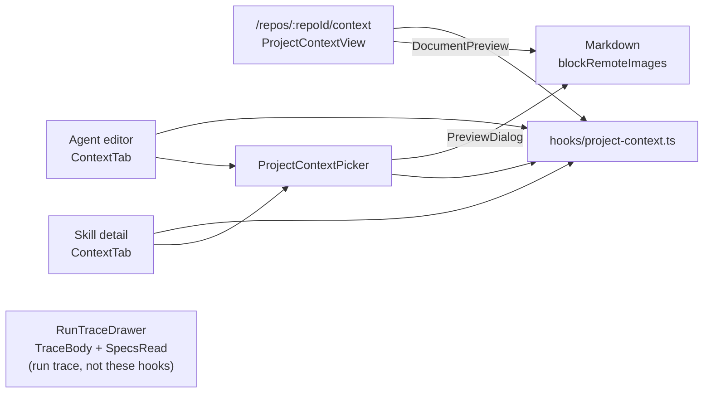

# Project Context in the UI

The studio lets a user browse the Markdown docs a repository exposes, attach them by hand to an agent or a skill, and see in the run trace what a run actually read. The client only moves data: every token number, limit and skip decision comes from the server. API shapes: [`../../server/README.md`](../../server/README.md) (API map); rules, limits and trace fields: [`../../server/docs/project-context.md`](../../server/docs/project-context.md). Contracts: `@devdigest/shared` `contracts/project-context.ts`. Spec: [`../../specs/2026-10-10-project-context.md`](../../specs/2026-10-10-project-context.md).

## Surfaces

1. **Page `/repos/:repoId/context`** (`src/app/repos/[repoId]/context/page.tsx:10`). Thin: breadcrumb, `useRepoNotFound`, then `ProjectContextView`. The view (`.../ProjectContextView/ProjectContextView.tsx:14`) is read-only: a list of discovered docs with the active patterns, a Refresh button (`listing.refetch()`), totals and the refresh time, and a preview pane. A failed listing shows `ErrorState` and never the previous list (`:27`). There is no create, edit or upload.
2. **Nav entry and shortcut.** `NAV` item `context` ("Project Context", `href /repos/:repoId/context`, `gKey: "d"`) and the `g d` entry in `SHORTCUTS` (`src/vendor/ui/nav.ts:26`, `:63`). `g`-then-key navigation reads `gKey` from `NAV` (`src/components/app-shell/hooks/useGlobalShortcuts.ts:45`).
3. **Shared picker** `src/components/project-context-picker/ProjectContextPicker.tsx:30`. Presentational: the owner passes `documents`, saved `attached` items and read-only `inherited` rows, and receives the whole new ordered path list through `onChange`. It holds only a filter string, the preview target and the drag source. Rows can be toggled, moved up or down (buttons) or dragged (`helpers.ts` `buildRows`, `matchesFilter`, `moveItem`). With `repoId == null` it shows a "select a repository" empty state (`:52`). `PreviewDialog` opens a modal preview with Escape to close and focus restored to the trigger.
4. **Agent editor "Context" tab.** `TABS` entry `context` (`AgentEditor/constants.ts:14`), rendered at `AgentEditor.tsx` as `<ContextTab agent>`. `ContextTab.tsx:20` loads the listing and the agent's attachments for the active repo (`useActiveRepo`), shows an "N of M attached" badge, the picker with skill-inherited rows read-only, a `role="alert"` warning listing `would_skip` paths, and a footer with total tokens per LLM call, the context/specs split and an "injected as untrusted" note. A save failure raises a toast.
5. **Skill detail "Context" tab.** `TABS` entry `context` (`SkillDetailView/constants.ts:5`), `<ContextTab skill>` in `SkillDetailView.tsx`. Titled "Project context to use" (`messages/en/skills.json`, `context.title`). Same picker without inherited rows, a `would_skip` warning, and a "Serializes as" preview of `## Project specifications` plus the attached paths (`ContextTab.tsx:49`, missing docs omitted).
6. **Run trace drawer.** `TraceBody.tsx:78-87` renders `prompt_assembly.specs` as the "Project context" block and `prompt_assembly.project_specs` as the "Project specifications" block (each only when not null; `PROMPT_COLORS.projectSpecs`). `SpecsRead` (`.../RunTraceDrawer/_components/SpecsRead/SpecsRead.tsx:10`) lists `specs_read` paths, then every `project_context[]` record with `status: "skipped"` and its translated reason (`runs` namespace, `trace.config.reason.*`). Older traces without the new fields show the "none" placeholder.

## Data hooks

All in `src/lib/hooks/project-context.ts`, re-exported from `hooks/index.ts`.

| Hook | Endpoint | Key |
|---|---|---|
| `useProjectDocuments(repoId)` | `GET /repos/:id/project-context` | `["project-context","listing",repoId]` |
| `useProjectDocument(repoId, path)` | `GET /repos/:id/project-context/document?path=` | `["project-context","document",repoId,path]` |
| `useAgentProjectContext(agentId, repoId)` | `GET /agents/:id/project-context?repo_id=` | `["project-context","agent",agentId,repoId]` |
| `useSetAgentProjectContext()` | `PUT /agents/:id/project-context` | writes the agent key; invalidates the listing |
| `useSkillProjectContext(skillId, repoId)` | `GET /skills/:id/project-context?repo_id=` | `["project-context","skill",skillId,repoId]` |
| `useSetSkillProjectContext()` | `PUT /skills/:id/project-context` | writes the skill key; invalidates every agent key (`agentAll`) and the listing |

Listing and document queries use `retry: false`. A PUT replaces the whole set, so the picker always sends the full ordered list and the response overwrites the cache with `setQueryData` (no refetch). Invalidating the listing refreshes `used_by_agents`. The skill mutation also invalidates agent keys because agents inherit skill docs. Trace data is not served by these hooks; it arrives with the run trace.

## Safe preview

Docs are untrusted repository content. Both previews (`DocumentPreview.tsx:41`, `PreviewDialog.tsx:37`) render `<Markdown blockRemoteImages>`. In `src/vendor/ui/primitives/Markdown.tsx` that flag renders an image as its alt text only (no request is made) and adds `rel="noopener noreferrer"` to links. Raw HTML is not rendered, because `react-markdown` runs without an HTML plugin.

## "Used by" popover

`UsedByPopover` shows "Used by N agents" (distinct `agent_id`, rows marked direct or via a skill) and renders nothing for 0. In the preview header it receives `used_by` from the document read. In list rows `RowUsedBy` (`DocumentList.tsx:27`) shows the listing's `used_by_agents` count and fetches `used_by` only when the popover is first opened, through the same `useProjectDocument` key as the preview, so opening a row's popover also warms the preview cache. While loading the panel shows a loading line, on failure an error line.

## Known limitations

- View-only: docs are changed in git and appear after Refresh; the page offers no authoring.
- Token and budget numbers (3 000 tokens per doc, 7 500 per run, 50 docs per set) are server constants returned in `limits`; the client displays server values and never recomputes them.
- No e2e flow covers the page, the tabs or the trace blocks; coverage is the component tests next to each component and `src/lib/hooks/project-context.test.tsx`, with `fetch` mocked.
- Spec AC-46 (a finding cites the attached document in a real LLM review) is a manual lab check and is not automated anywhere.
- Row-level "Used by" lists load lazily on first open, so the first open shows a loading state.
