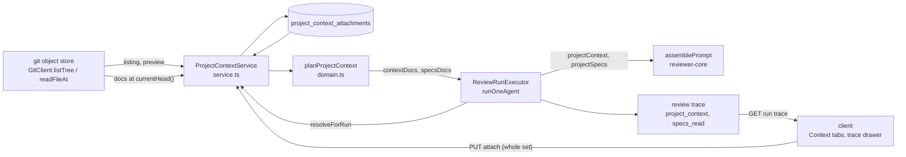

# Project Context: attach repository docs to agents and skills

Users pick Markdown docs of a repository and attach them **by hand** to an
agent (`## Project context`) or a skill (`## Project specifications`), per
repository. At run start the attached docs are injected as untrusted blocks;
the run trace records what was read. Spec:
[`../../specs/2026-10-10-project-context.md`](../../specs/2026-10-10-project-context.md).
Module: `src/modules/project-context/{constants,domain,repository,service,routes}.ts`.
Contracts: `@devdigest/shared` `contracts/project-context.ts`.

## Data flow

## Discovery

- Source of truth is the **git object store** at `GitClient.currentHead()`
  (== `origin/<default branch>` after `sync()`), listed with
  `git ls-tree -r -l -z <sha>` (`GitClient.listTree`). Never the working tree,
  never a PR head. Untracked/ignored files (`node_modules/`) therefore cannot
  appear, and symlinks (mode `120000`) and submodules (`160000`) are rejected.
- A tracked blob is a document when its path (a) is safe (`isSafeDocPath`:
  allowlist `\w . - / space`, `.md`, no `..`/`.`/`.git` segment, no leading
  `/` or `-`, no `: \ " < > `` ` `` or control chars) and (b) matches the
  configured patterns. Dot-directories match (`.devdigest/specs/`).
- Patterns: env `PROJECT_CONTEXT_PATTERNS` (`;`-separated; globs contain
  commas), read only in `platform/config.ts`. Default
  `**/{specs,docs,insights}/**/*.md`. Own glob matcher (`**`, `*`, `?`,
  `{a,b}`; case-sensitive); no dependency.
- Type = nearest folder segment named `specs|docs|insights`, else `other`.
- Any git failure → `503 project_context_repo_unavailable`; no stale list.

## Numbers

| Constant | Value | Meaning |
|---|---|---|
| `DOC_CAP_TOKENS` | 3000 | one wrapped doc above this is skipped (`over_budget`) |
| `RUN_BUDGET_TOKENS` | 7500 | all injected docs of one run |
| `MAX_ATTACHMENTS_PER_SET` | 50 | docs per (owner, repo) |
| `MAX_READ_BYTES` | 262 144 | larger blobs are not read; tokens ≈ `ceil(size/4)`; flagged `over_cap` |
| `MAX_PREVIEW_BYTES` | 2 097 152 | preview refuses larger blobs (413) |

They are returned as `limits` in every response; the UI never recomputes them.

## Token parity (AC-44)

Every token count is taken over `renderProjectDocBlock({path, content})` from
`@devdigest/reviewer-core` (the delimiter-wrapped block the model sees) with
the container tokenizer, so the listing, the Context-tab footers, the budget
warning and the run trace agree for unchanged content. Counts are cached per
`repo@sha:path` (bounded, 5 000 entries).

## Plan (dedupe + budget)

`planProjectContext` (domain, pure) backs both the pre-run warning and the
run-time pass: a path attached directly appears only in the agent list; a path
inherited from several skills appears once at its first position; budget is
consumed in prompt order (agent list, then skill list); a skipped doc consumes
nothing. Skills count only when `agent_skills.enabled` and `skills.enabled`.

Skip reasons: `missing | unreadable | untracked | not_matched | unsafe | empty |
over_budget | repo_unavailable` (`untracked` is reserved; a tree-based read
cannot produce it).

## Run time and trace fields

`ReviewRunExecutor.runOneAgent` calls `resolveForRun` (through the local
`ProjectContextResolver` port, never the module) right after the skill blocks
are built, then passes `projectContext` / `projectSpecs` to the engine **only
when non-empty**, so an agent with no attachments keeps a byte-identical prompt.
`resolveForRun` never throws; it takes `currentHead()` once and reads every doc
from that sha (default branch, never the PR head). A missing clone gives every
attached doc a `repo_unavailable` record and the run continues without docs.

Skip checks per doc, in order: absent from the tree `missing` -> no longer
matching the patterns `not_matched` -> symlink/submodule/unsafe path `unsafe` ->
`readFileAt` throws `unreadable` -> blank `empty` -> over the 3 000 cap or the
7 500 run budget `over_budget`.

| Trace field | Content |
|---|---|
| `prompt_assembly.specs` | the `## Project context` text (agent docs); null when none |
| `prompt_assembly.project_specs` | the `## Project specifications` text (skill docs); null when none |
| `prompt_assembly.project_context_tokens` / `project_specs_tokens` | injected tokens per section (0 when none; default for older traces) |
| `project_context[]` | one record per effective doc in prompt order: `path`, `section`, `source` (`agent` or skill name), `order`, `tokens`, `status` (`injected`/`skipped`), `reason` |
| `specs_read` | injected paths in prompt order, then Intent Layer plan/spec refs not already listed |

On failure or cancel after resolution the trace keeps `project_context` and
`specs_read`; before resolution (or when the pre-work fails) both are empty.
Older traces lack the new fields and parse to defaults.

Live Log: one summary line per section (`project context: N injected (+T
token(s))`, same for `project specifications`), one line per injected doc with
its tokens and one per skipped doc with its reason. Paths, counts, tokens and
reasons only; the summary `data` is mirrored to the structured logger.

## API

| Route | Notes |
|---|---|
| `GET /repos/:id/project-context` | listing: documents, totals, `refreshed_at`, `patterns`, `limits` |
| `GET /repos/:id/project-context/document?path=` | content + tokens + `used_by`; path must be in the listing, else 404 |
| `GET /agents/:id/project-context?repo_id=` | ordered items, `inherited`, `totals`, `would_skip` |
| `PUT /agents/:id/project-context` | body `{repo_id, paths[]}` whole-set replace (unique, ≤ 50) |
| `GET/PUT /skills/:id/project-context` | same shape without `inherited`/`totals.*` split |

Errors: 404 unknown/cross-workspace repo, agent, skill or path; 422 invalid
body or any path outside the listing (nothing is saved); 503 missing clone.
Saves touch only `project_context_attachments`, never agent/skill versions.

## Security

Paths and content are untrusted. Paths are validated against the git tree
before they are read or saved. Logs carry paths, counts, tokens, reasons only,
never document text. Workspace scoping is in the repository on every query.
