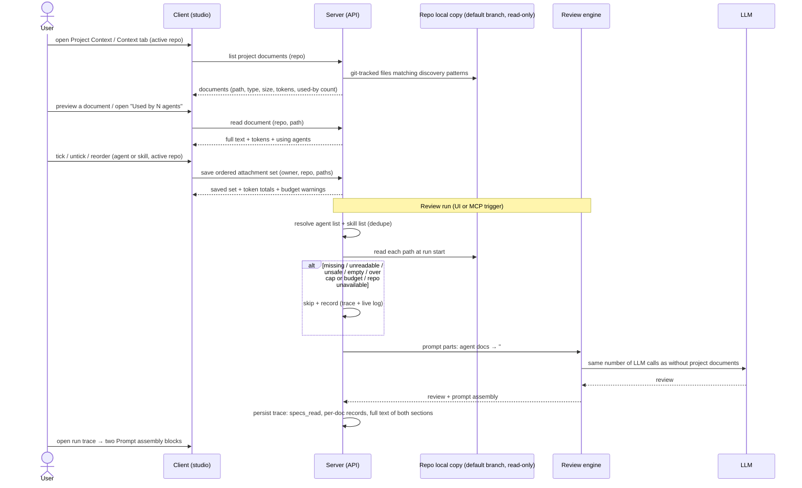

# Project Context — attach repository docs to agents and skills

- **Status:** approved
- **Date:** 2026-10-10
- **Scope:** server (`@devdigest/api`), client (`@devdigest/web`), `@devdigest/shared` contracts (both vendored copies). `reviewer-core` is touched through its prompt assembly. It already has a `## Project context` slot and now also needs a separate `## Project specifications` section (AC-50). How that is done is the planner's decision.
- **Related:**
  - Lab brief: `materials/5/Lab page - Hands-On Lab (video 2).md`, "Крок 2. Фіча 1: Project Context Folder"
  - User prompts: `materials/5/prompts.txt` ("Написання специфікації для фічі Project Context", "Відповіді на уточнюючі питання Specreator для Project Context", "Уточнення відкритого питання про футер/токени")
  - Designs: `materials/5/images/01-project-context-page.png`, `02-agent-editor-context-tab.png`, `03-skill-editor-context-tab.png`, `04-agent-run-trace-prompt-assembly.png`; `materials/5/Lab 05/DevDigest Design (standalone).html` (artboards "Project Context (N6)" and "Project Context · empty". The empty artboard's content is inside the compressed bundle and could not be read.)
  - Existing behaviour: `server/docs/intent-layer.md` (safe-path rules, untrusted wrapping, current use of `specs_read`, and the doc caps of 12 000 chars per doc and 30 000 total), `server/docs/run-lifecycle-and-cost.md`, `reviewer-core/README.md` (prompt slots), `docs/agent-prompts/README.md` (prompt layout)
  - INSIGHTS: see "INSIGHTS applied" at the end of this spec

## Summary

Reviewers do not see the project's own specs, architecture notes, or recorded insights. As a result they cannot flag violations of invariants that are written down in the repo but are not visible in the diff, for example "`api/` must not import `db/` directly". Project Context lets the user find the Markdown documents in a repository, preview them, and attach them by hand to agents and skills, per repository. When a review runs, the attached documents are read from the repository's synced default branch and added to the prompt as untrusted, delimited data. Documents attached to the agent go into a `## Project context` section. Documents inherited from the agent's skills go into a separate `## Project specifications` section. No extra LLM call is made. Before the run, the UI shows how many tokens the documents will cost. After the run, the trace shows which documents were read and their exact text.

## Goals / Non-goals

**Goals**
- Find `.md` documents in a repository with configurable discovery patterns. The default is `**/{specs,docs,insights}/**/*.md`.
- Give a read-only Project Context page that lists the documents, previews them, and shows a token count for each and a total.
- Let the user attach documents to an agent (agent editor, Context tab) and to a skill (skill editor, "Project context to use"), by hand, per repository, and in a chosen order.
- At run start, inject agent documents as an untrusted `## Project context` section and skill documents as an untrusted `## Project specifications` section, both covered by the injection guard.
- Enforce a per-run budget and a per-document cap, and warn in the UI before the run when a selection exceeds them.
- Record what happened in the run: the `specs_read` list, a per-document record, and the full text of both sections in Prompt assembly.
- Skip a missing, unreadable, or over-limit document without failing the run, and record the skip.
- Show "Used by N agents" for each document, with the list of agents available on click.

**Non-goals**
- Automatic selection of documents based on PR content (planned as a separate feature).
- Editing, creating, uploading, renaming, or deleting documents from DevDigest. This feature is view-only (D-4).
- Versioning of attachments. Attachment changes do not create agent or skill versions.
- Coverage metrics, including the "78 COVERAGE" ring in design 01.
- Embedding, chunking, or semantic indexing of documents. The design's "chunks" wording is replaced by "tokens total".
- Onboarding Generator.
- Project context for the external GitHub/CI runner that uses `reviewer-core` outside the studio server (confirmed out of scope).
- Editing the discovery patterns from the UI. Patterns are server configuration.

## Decisions

**Made by the user up front**
- **D-1** Documents are attached by hand only. Nothing is selected automatically.
- **D-2** Attachments store repository-relative paths, never the document text. The text is read at run start.
- **D-3** A token count is shown for each document and as a total for the selection. In the design, "chunks" becomes "tokens total".
- **D-4** View-only. Rationale: documents live in the server's local clone of the repository. That clone is a git working tree, and every sync moves it to the remote default branch. An edit made there would either be lost on the next sync or block it, and it would never reach the real repository without commit, push, and auth flows that this feature does not have. Editing therefore needs its own feature with a git write path.
- **D-5** If an attached file is missing at run time, it is skipped and the skip is recorded in the trace.
- **D-6** For usage, only the number of agents is shown ("Used by N agents"). There are no coverage metrics and no versioning.
- **D-7** The run trace shows the block "Project context — attached specs (untrusted)" with its full text available, and fills `specs_read`.

**Resolved clarifications (user answers, 2026-10-10)**
- **D-8** (Q1) Attachments are scoped to an owner (agent or skill) and a repository. A run on another repository receives none of them.
- **D-9** (Q2) At run time, documents are read from the repository's local copy at its default branch as last synced. They are not read at the PR head.
- **D-10** (Q3) `specs_read` lists the injected project documents first, followed by the Intent Layer plan and spec refs not already listed. Per-document records are kept in addition.
- **D-11** (Q4) Skill documents go into a separate `## Project specifications` section, as in design 03. Agent documents go into `## Project context`. There are two untrusted sections, each with delimiters and covered by the injection guard, and both are shown in the trace's Prompt assembly.
- **D-12** (Q5) There is a per-run budget and a per-document cap. Over-limit documents are skipped as `over_budget`, and the UI warns. The values are set by the planner, with the Intent Layer caps (12 000 chars per document, 30 000 total) as the precedent.
- **D-13** Documents matched only by a custom pattern get the type `other`.
- **D-14** Only git-tracked files are listed.
- **D-15** Dot-directories are matched (for tracked files).
- **D-16** "Used by N agents" counts disabled agents and skills too.
- **D-17** Patterns are server configuration that applies to all repositories.
- **D-18** The proposed performance thresholds are accepted (NFR-5).
- **D-19** Remote images are blocked in the preview.
- **D-20** Failed and cancelled traces include the per-document records once resolution has finished.
- **D-21** The CI runner is out of scope.
- **D-22** "Used by N agents" opens the list of agents on click.
- **D-23** The token footer uses the wording "≈ N tokens per LLM call".
- **D-24** A document attached directly to the agent appears only in `## Project context`. A document inherited from several skills appears once in `## Project specifications`.
- **D-25** `## Project specifications` comes immediately after `## Project context`.
- **D-26** The trace label for the skill section is "Project specifications — skill specs (untrusted)".

## Definitions

- **Project document**: a git-tracked `.md` file in a repository's local copy, on the synced default branch, whose repository-relative path matches the discovery patterns. Paths that pass through dot-directories are included.
- **Discovery patterns**: glob patterns from server configuration, the same for all repositories, matched against repository-relative paths. Default: `**/{specs,docs,insights}/**/*.md`.
- **Document type**: `specs`, `docs`, `insights`, or `other`, shown as a badge.
- **Attachment**: an owner (an agent or a skill), a repository, a repository-relative path, and an order position.
- **Agent list**: for a run of agent A on repository R, A's direct attachments for R, in order. These are rendered under `## Project context`.
- **Skill list**: for the same run, the attachments for R of every skill that is attached to A, enabled for A, and enabled globally. They are taken in skill order and then in each skill's document order, and rendered under `## Project specifications`.
- **Effective project context**: the agent list plus the skill list after de-duplication (AC-27).
- **Run budget / document cap**: the maximum tokens of project documents injected per run, across both sections, and the maximum tokens for a single document. The planner sets the values.

## User stories

- **US-1** As a reviewer-configurer, I want to browse and preview the Markdown docs of the active repository, so that I can decide which ones are worth giving to reviewers.
- **US-2** As a reviewer-configurer, I want to attach selected docs to an agent in a chosen order and see their token cost, so that the agent reviews against our written rules without blowing the budget.
- **US-3** As a skill author, I want to attach docs to a skill, so that every agent using the skill inherits them.
- **US-4** As a PR author or reviewer, I want attached docs to be part of every review run as untrusted context, so that findings can cite our own specs and invariants.
- **US-5** As a user inspecting a run, I want to see which docs were read, what they cost in tokens, and their exact injected text, so that I can trust and debug the review.
- **US-6** As a user, I want a run to keep working when an attached doc was renamed, deleted, or is too large, and to be told about it, so that stale or oversized attachments never break reviews silently.
- **US-7** As a reviewer-configurer, I want to see how many agents use each doc and which ones they are, so that I understand the impact of a document before I rely on it.
- **US-8** As an operator, I want to configure which folders are scanned for docs, so that repositories with other layouts are supported.

## Workflow

**Ownership**
- **Server** owns discovery, path validation, token counting, budget and cap checks, the attachment records, usage counts, run-time resolution and reading, and the trace document.
- **Repository local copy** owns the document content. DevDigest never writes to it as part of this feature.
- **`@devdigest/shared`** owns every request and response shape listed under Contracts, in both vendored copies.
- **Client** owns presentation only. It never counts tokens, applies limits, or reads repository files itself.
- **Review engine** owns how the two sections are placed in the prompt and how they are wrapped as untrusted data.

## Acceptance criteria

### Discovery and the Project Context page (US-1, US-7, US-8)

- **AC-1** (US-1): When the user opens the Project Context page for the active repository, the system shall list every git-tracked `.md` file on the repository's synced default branch whose repository-relative path matches the configured discovery patterns, including paths through dot-directories such as `.devdigest/specs/`. Each entry shall show its path, document type, size, and token count.
- **AC-2** (US-1): The system shall exclude from the listing every file that is not tracked by the repository's version control, including untracked or ignored dependency and build folders such as `node_modules/`.
- **AC-3** (US-1): The system shall exclude from the listing every entry that is a symbolic link or that resolves to a location outside the repository's local copy.
- **AC-4** (US-8): The system shall read the discovery patterns from server configuration that applies to all repositories. Where the patterns have been changed, the system shall apply them on the next listing or refresh, without the repository having to be re-imported.
- **AC-5** (US-1): The system shall assign each document the type `specs`, `docs`, or `insights` from the matching folder segment nearest to the file, for example `server/docs/specs/a.md` → `specs`. A document with none of these segments in its path shall get `other`.
- **AC-6** (US-1): When the user selects a document, the Project Context page shall show a rendered, read-only preview of the document's full current content, together with the document's token count and "Used by N agents".
- **AC-7** (US-1): The Project Context page shall offer no action to create, upload, edit, rename, or delete documents. The design's Edit tab and its create, folder, and upload toolbar actions are absent.
- **AC-8** (US-1): The Project Context page shall show a footer in the form `<N> files · <T> tokens total`, where `T` is the sum of the listed documents' token counts, together with the time the listing was last refreshed. The word "chunks" shall not appear.
- **AC-9** (US-1): When the user triggers refresh, the system shall re-read the repository's local copy and update the listing, the per-document token counts, the footer, and the usage counts.
- **AC-10** (US-1): If the repository's local copy contains no matching documents, then the Project Context page shall show an empty state that names the active discovery patterns.
- **AC-11** (US-1): If the repository's local copy is unavailable, then the Project Context page shall show an error state with a retry action and shall not show a stale document list.
- **AC-12** (US-7): The system shall show, for each document, "Used by N agents". N is the number of distinct agents in the workspace that have the document attached for this repository, directly or through an attached skill, counting enabled and disabled agents and skills alike.
- **AC-13** (US-7): The Project Context page shall show no coverage metric.
- **AC-14** (US-1): The sidebar shall contain a "Project Context" navigation entry that opens the Project Context page for the active repository.
- **AC-53** (US-7): When the user clicks "Used by N agents", the system shall show the names of those N agents. Each agent shall be marked as direct or "via skill <name>" and shall link to that agent's editor. When N is 0, nothing opens.

### Agent editor — Context tab (US-2)

- **AC-15** (US-2): The agent editor shall have a Context tab. The tab lists the active repository's project documents, and each row shows a checkbox, the file name, the containing folder, a type badge, the token count, and a Preview action.
- **AC-16** (US-2): When the user checks or unchecks a document on the Context tab, the system shall save the agent's attachment set for the active repository. The "X of Y attached" counter shall update without a page reload.
- **AC-17** (US-2): When the user reorders the attached documents, either by dragging or by an equivalent keyboard action, the system shall save the new order. That order shall be the order of the documents in the `## Project context` section.
- **AC-18** (US-2): The Context tab shall show a footer reading "≈ N tokens per LLM call". N is the approximate token total of the agent's effective project context for the active repository, with each document counted once. The footer shall break the total down into `## Project context` (direct) and `## Project specifications` (inherited from skills), and shall note that both are injected as untrusted blocks into every run.
- **AC-19** (US-2, US-3): The Context tab shall list the documents the agent inherits through its attached skills, labelled "via skill <name>". They shall not be toggleable from the agent's tab.
- **AC-20** (US-2): When the user types in "Filter documents", the Context tab shall show only documents whose path contains the typed text, ignoring case, and shall not change any attachment.
- **AC-21** (US-2, US-6): If an attached path is not present in the current listing, then the Context tab shall show it marked "missing", exclude it from the token total, and offer a detach action.
- **AC-22** (US-2): While no repository is active, the Context tab shall show a prompt to select a repository and no attach controls.
- **AC-23** (US-2, US-3): When an attachment is added, removed, or reordered, the system shall not create a new agent version or skill version, and shall not change any other field of the agent or skill.
- **AC-54** (US-2, US-3, US-6): If a selected document exceeds the document cap, or the effective project context exceeds the run budget, then the agent's Context tab and the skill's "Project context to use" section shall show a warning. The warning names each document that would be skipped as `over_budget` at run time, following the order defined in AC-34.

### Skill editor — "Project context to use" (US-3)

- **AC-24** (US-3): The skill editor shall have a Context tab with a "Project context to use" section. It shall have the same rows, filter, preview, and ordering as AC-15 to AC-17 and AC-20, plus a "N attached" counter, the token total of the skill's attached documents for the active repository, and the note "Any agent using this skill inherits these documents."
- **AC-25** (US-3): The "Project context to use" section shall show a "Serializes as" preview: the heading `## Project specifications` followed by the skill's attached paths in order, matching how those documents are identified in that section of the prompt.

### Attachment validation and tenancy (US-2, US-3)

- **AC-26** (US-2, US-3): If an attachment request contains a path that is not in the repository's current listing, then the system shall reject the whole request with a validation error and leave the existing attachment set unchanged. This covers paths that do not match the patterns, use traversal or absolute forms, are symbolic links, are untracked, are not `.md`, or no longer exist.
- **AC-48** (US-2, US-3): If the agent, the skill, or the repository in an attachment request does not exist or belongs to another workspace, then the system shall respond not-found and change nothing.
- **AC-49** (US-2, US-3): When an agent or a skill is deleted, or a repository is removed from the workspace, the system shall remove the attachments that belong to it.

### Run time (US-4, US-6)

- **AC-27** (US-4): When a review run starts for agent A on a pull request of repository R, the system shall resolve the agent list and the skill list as defined above. Duplicates are handled as follows. A path that A has attached directly appears only in the agent list. A path inherited from several skills appears once in the skill list, at its first position.
- **AC-28** (US-4): When a review run starts, the system shall read each document of the agent list from R's local copy at its default branch as last synced, and include the documents' full text, in order, under one `## Project context` section.
- **AC-50** (US-3, US-4): When a review run starts, the system shall read each document of the skill list from the same source as AC-28, and include the documents' full text, in order, under a separate `## Project specifications` section. That section comes immediately after `## Project context`, or takes its place when `## Project context` is absent.
- **AC-29** (US-4): The system shall place each injected document, in either section, in its own untrusted delimited block that names the document's repository-relative path. Document content shall not be able to end that block early, and a path shall not be able to break out of the delimiter.
- **AC-30** (US-4): The system shall apply the prompt's injection guard to both the `## Project context` and the `## Project specifications` sections, so that their content is treated as data and never as instructions.
- **AC-31** (US-4): The system shall make the same number of LLM calls for a run with project documents as for the same agent and PR without them.
- **AC-32** (US-6): If an attached document is missing, unreadable, untracked, no longer matched by the discovery patterns, a symbolic link, or empty after trimming at run start, then the system shall skip that document, continue the run, and record the path and the skip reason in the run trace and the live log.
- **AC-33** (US-4): If a section has no injected document, then that section shall be absent from the prompt. If neither section has one, the prompt shall be identical to the prompt of an agent with no attachments.
- **AC-34** (US-4, US-6): If a document exceeds the document cap, or adding it would exceed the run budget, then the system shall skip it with the reason `over_budget`, record it, and continue with the next document. The budget is consumed in prompt order: the agent list first, then the skill list. The planner sets the values, with the Intent Layer caps (12 000 chars per document, 30 000 total) as the precedent.
- **AC-35** (US-6): If the repository's local copy is unavailable at run start, then the system shall skip every attached document with the reason `repo_unavailable` and complete the review without project documents.
- **AC-36** (US-4): The system shall use the document content as read at run start for the whole run. Later changes to the local copy shall not affect a run that is already in progress.
- **AC-37** (US-4): The system shall apply AC-27 to AC-36 and AC-50 to every review run executed by the studio server, whether the run was triggered from the UI or through the MCP `run_agent_on_pr` tool.

### Run trace (US-5)

- **AC-38** (US-5): When a run completes, the system shall record in the trace configuration's `specs_read` the repository-relative paths of the injected project documents in prompt order (`## Project context` first, then `## Project specifications`). These are followed by the plan and spec refs fetched by the Intent Layer that are not already listed.
- **AC-39** (US-5): When a run completes, the system shall record one entry per document of the effective project context. Each entry holds the path, section (`project_context` or `project_specifications`), source (`agent` or the skill's name), order, token count, status (`injected` or `skipped`), and the skip reason when skipped.
- **AC-40** (US-5): While at least one agent-list document was injected, the run trace's Prompt assembly section shall show a block labelled "Project context — attached specs (untrusted)". Opening the block shall show that section's full text exactly as sent to the model, delimiters included.
- **AC-51** (US-5): While at least one skill-list document was injected, the run trace's Prompt assembly section shall show a separate block labelled "Project specifications — skill specs (untrusted)". Opening the block shall show that section's full text exactly as sent to the model, delimiters included.
- **AC-41** (US-5): The run trace Configuration section shall list the `specs_read` paths under "Specs read". When documents were skipped, it shall also show each skipped path with its reason, visually distinct from the injected ones.
- **AC-42** (US-5): When a run's project documents are resolved, the live log shall show a summary line with the injected document count and total tokens for each section, one line per injected document with its tokens, and one line per skipped document with its reason.
- **AC-43** (US-5): If a trace was recorded before this feature, or contains no project-document data, then the run trace shall render without errors and show "none" for Specs read.
- **AC-52** (US-5, US-6): If a run fails or is cancelled after project-document resolution has finished, then the persisted trace shall include the per-document records (AC-39) and `specs_read`. If the run fails or is cancelled before resolution finishes, those fields shall be empty.

### Token counting (US-2, US-3, US-5)

- **AC-44** (US-2, US-5): The system shall compute every token count it displays (Project Context page, agent and skill Context tabs, budget warnings, run trace) over the same text the document contributes to the prompt, including its delimiter wrapper, with the same counting method the run trace uses. For unchanged content, the count shown before a run therefore equals the count recorded in the trace.

### Verification scenario (US-4)

- **AC-45** (US-4): When a document containing the invariant "module `api/` must not import `db/` directly" is attached to an agent, and that agent reviews a PR that adds such an import, the run's prompt shall contain that document's text under `## Project context`, identified by its path, and the trace's `specs_read` shall list the path.
- **AC-46** (US-4): When the run in AC-45 completes, at least one finding shall cite the attached document's path or the invariant it states. This is a manual, LLM-dependent check and not a deterministic gate.

### Preview safety (US-1)

- **AC-47** (US-1): The system shall render document previews without running scripts or embedded HTML from the document, and without loading remote resources such as remote images.

## Non-functional requirements

- **NFR-1 Security (untrusted input).** Document content and paths come from the repository and are untrusted. Content always reaches the model inside delimited untrusted blocks under the injection guard, in both sections (AC-29, AC-30). Every path is validated against the current listing before it is read or saved: no traversal, no absolute paths, no symbolic links, git-tracked `.md` only, and inside the local copy (AC-3, AC-26, AC-32). The path-safety rules shall be at least as strict as the existing Intent Layer doc-path rules described in `server/docs/intent-layer.md` "Security notes". Documents are read from the synced default branch, never from the PR head, so a PR cannot change the documents it is judged against (D-9).
- **NFR-2 Security (data handling).** Document text shall not appear in server logs. Logs record only paths, counts, token totals, and skip reasons. No secret shall be stored in attachment data. The preview loads no remote resources (AC-47).
- **NFR-3 Tenancy.** Every listing, read, attachment, and usage operation is scoped to the caller's workspace. A request that crosses workspaces responds not-found (AC-48).
- **NFR-4 Cost.** Project documents add no LLM call (AC-31). Token cost is bounded by the run budget and the document cap (AC-34), visible before the run (AC-18, AC-24, AC-54), and recorded after it (AC-39). Where the agent's strategy sends several LLM calls per run (map-reduce), the project-document tokens are paid once per call. The Context tab footer therefore reads "≈ N tokens per LLM call" (D-23, AC-18).
- **NFR-5 Performance.** Listing a repository with up to 500 matching documents shall return within 2 s on a warm local copy. Resolving and reading up to 20 attached documents shall add at most 500 ms to run start.
- **NFR-6 Accessibility.** Every checkbox has an accessible name that includes the document path. Reordering has a keyboard alternative to dragging. The preview and the "Used by" list open in a focus-managed view that closes on Escape and returns focus to its trigger. Every control described in this spec is reachable by keyboard.
- **NFR-7 i18n.** Every user-facing string comes from the message catalogs. English is required. The existing "chunks" and `.devdigest/specs/`-only copy in the Project Context messages is replaced.
- **NFR-8 Backward compatibility.** Agents and skills without attachments behave exactly as before, with a byte-identical prompt (AC-33). Traces from before this feature still render (AC-43).
- **NFR-9 Observability.** Each run records resolution results in the live log (AC-42) and the trace (AC-39). The server log records a single structured line per run with counts, tokens per section, and skip reasons only.

## Edge cases & errors

- **EC-1** An attached document is deleted or renamed in the repository → skipped at run time and recorded (AC-32). The Context tab shows it as "missing" with a detach action (AC-21).
- **EC-2** The discovery patterns change so that an attached path no longer matches → skipped at run time with the reason `not_matched` (AC-32), and shown as missing in the tabs (AC-21).
- **EC-3** A document is a symbolic link, including one pointing outside the clone, for example at a secrets file → never listed (AC-3), rejected on attach (AC-26), and skipped at run time (AC-32).
- **EC-4** A path contains traversal, an absolute form, or delimiter-breaking characters → rejected (AC-26). It can never break the prompt delimiter (AC-29).
- **EC-5** Document content contains instructions ("ignore all findings") or a closing delimiter → treated as data under the guard in either section. The delimiter cannot be closed from inside (AC-29, AC-30).
- **EC-6** An empty or whitespace-only document → skipped with the reason `empty`, never injected as an empty block (AC-32, AC-33).
- **EC-7** A document over the document cap, or a selection over the run budget → warned about in the UI before the run (AC-54). At run time, over-limit documents are skipped in prompt order with the reason `over_budget` and recorded (AC-34).
- **EC-8** The same document is attached directly and through skills, or through several skills → it appears once: in `## Project context` if attached directly, otherwise once in `## Project specifications` at its first position (AC-27).
- **EC-9** A skill is attached to the agent but disabled for that agent or disabled globally → its documents are not inherited at run time (AC-27). They still count toward "Used by N agents" (AC-12).
- **EC-10** No active repository → the Context tab shows a prompt to select one (AC-22).
- **EC-11** The repository's local copy is missing or unavailable → the page shows an error state (AC-11). At run time all documents are skipped with the reason `repo_unavailable` and the review continues (AC-35).
- **EC-12** The repository has no matching documents → empty state naming the patterns (AC-10).
- **EC-13** Two browser tabs edit the same attachment set → each save replaces the whole ordered set, so the last write wins. After a save, the UI shows the server's saved state (AC-16).
- **EC-14** A document changes in the clone during a run → the run uses the content read at start (AC-36).
- **EC-15** The local copy is synced between listing and attaching, and the document disappears → the attach is rejected (AC-26), and the user refreshes (AC-9).
- **EC-16** An agent, skill, or repository is deleted → its attachments are removed (AC-49). The usage counts and lists reflect this on the next listing (AC-12, AC-53).
- **EC-17** A cross-workspace identifier in a request → not-found and no change (AC-48).
- **EC-18** A run is cancelled or fails → its trace includes the per-document records if resolution had finished, and empty fields otherwise (AC-52).
- **EC-19** A document contains raw HTML, scripts, or remote images → none are executed or loaded in the preview (AC-47).
- **EC-20** A dependency folder such as `node_modules/pkg/docs/README.md` matches the default pattern → excluded because it is not tracked (AC-2).
- **EC-21** A tracked document under a hidden directory such as `.devdigest/specs/` → listed (AC-1).
- **EC-22** The PR itself adds or modifies an attached document → the run uses the default-branch version, and a document that exists only in the PR is treated as missing (AC-28, AC-32). PR-linked documents remain covered by the Intent Layer.
- **EC-23** The same agent reviews PRs in two repositories → each run gets only the attachments for its own repository (D-8, AC-27).

## Contracts

These describe behaviour. Exact route paths, schema names, and storage are the planner's decision. Shapes go into `@devdigest/shared` first, then into consumers. The server and client vendored copies have drifted (server INSIGHTS), so only the targeted change is ported.

**Existing scaffolding to reconcile.** `@devdigest/shared` already defines `SpecFile {path, content?, size?, updated_at?}` and `IndexStatus {status, pct, message?, chunks_indexed?}`. The client has `useContextFiles` / `useReindexContext` hooks pointing at `/repos/:id/context` and a `context` message namespace with "chunks" and `.devdigest/specs/` wording. No server route exists yet, and the sidebar has no Project Context entry. The planner decides whether to extend or replace these. `chunks_indexed` must not drive any UI (D-3).

**Project document (list item)**, owned by the server and derived from the repository's local copy on the synced default branch:
- `path`: repository-relative and POSIX-style. This is the identity.
- `type`: `specs` | `docs` | `insights` | `other`.
- `size_bytes`: integer.
- `tokens`: integer, as defined in AC-44.
- `over_cap`: boolean (AC-54).
- `used_by_agents`: integer (AC-12).

**Listing response**: the documents, `total_files`, `total_tokens`, `refreshed_at` (ISO timestamp), and `patterns` (the discovery patterns in effect).

**Document read**: input is the repository and the path. Output is `path`, `type`, `tokens`, `content` (full text), and `used_by` (a list of `{agent_id, agent_name, via: 'direct' | <skill name>}`, AC-53). Errors: not-found for an unknown or cross-workspace repository, or a path not in the listing. Repository unavailable is a distinct error, so the UI can show AC-11.

**Attachment set**, owned by the server and persisted:
- Key: owner kind (`agent` | `skill`), owner id, and repository id (D-8).
- Value: an ordered list of paths. The position in the list is the order.
- Save replaces the whole ordered list (EC-13). The response returns the saved list, each path's current `tokens`, `missing`, and `over_cap` flags, the set's token total, and any budget warning (AC-54).
- For agents, the read response also carries the inherited documents, each as `{path, via_skill_id, via_skill_name, tokens, missing, over_cap}`, the token totals per section, and the documents that would be skipped as `over_budget` (AC-18, AC-19, AC-54).
- Errors: validation error (422, per the server's existing input-validation convention) for any path not in the listing, and the whole request is rejected (AC-26). Not-found for an unknown or cross-workspace owner or repository (AC-48).
- Attachment changes never change agent or skill versions (AC-23).

**Run trace additions** (persisted inside the existing single trace document; every new field is optional or defaulted, so older traces still parse, AC-43):
- `specs_read: string[]`: the injected paths in prompt order, followed by the Intent Layer refs not already listed (AC-38).
- `project_context`: a list of `{path, section: 'project_context' | 'project_specifications', source: 'agent' | <skill name>, order, tokens, status: 'injected' | 'skipped', reason?: 'missing' | 'unreadable' | 'untracked' | 'not_matched' | 'unsafe' | 'empty' | 'over_budget' | 'repo_unavailable'}` (AC-39). It is also present on failed and cancelled traces once resolution has finished (AC-52).
- `prompt_assembly.specs`: the full `## Project context` text exactly as sent, or null. This field already exists.
- A new prompt-assembly field holding the full `## Project specifications` text exactly as sent, or null (AC-51).
- Token totals for each of the two sections, next to the existing `skills_tokens`.

**Discovery configuration**: server configuration listing the glob patterns, the same for all repositories. Default `**/{specs,docs,insights}/**/*.md`. Not editable in the UI.

**Limits**: the run budget (tokens across both sections) and the document cap (tokens per document) are server-defined values. The planner sets them, with the Intent Layer precedent of 12 000 chars per document and 30 000 total.

## Open questions

None. All questions were resolved by the user on 2026-10-10 (D-8 to D-26). The planner still has to set the numeric budget and cap values, as the user delegated (D-12).

## Traceability

| User story | AC | Edge case / NFR | Verification hint |
|---|---|---|---|
| US-1 | AC-1, AC-2, AC-3, AC-5, AC-6, AC-7, AC-8, AC-9, AC-10, AC-11, AC-14, AC-47 | EC-3, EC-11, EC-12, EC-19, EC-20, EC-21, NFR-1, NFR-2, NFR-5, NFR-6, NFR-7 | integration (listing on a fixture repo) + client component + e2e |
| US-2 | AC-15, AC-16, AC-17, AC-18, AC-19, AC-20, AC-21, AC-22, AC-23, AC-26, AC-44, AC-48, AC-49, AC-54 | EC-1, EC-2, EC-7, EC-10, EC-13, EC-15, EC-16, EC-17, EC-23, NFR-3, NFR-4, NFR-6 | integration (attachment API) + client component + e2e |
| US-3 | AC-19, AC-23, AC-24, AC-25, AC-26, AC-48, AC-49, AC-50, AC-54 | EC-8, EC-9 | integration + client component + hermetic unit (prompt) |
| US-4 | AC-27, AC-28, AC-29, AC-30, AC-31, AC-33, AC-34, AC-36, AC-37, AC-45, AC-46, AC-50 | EC-4, EC-5, EC-6, EC-7, EC-8, EC-9, EC-14, EC-22, EC-23, NFR-1, NFR-4, NFR-5, NFR-8 | hermetic unit (prompt) + integration (run with mocked LLM) + manual (AC-46) |
| US-5 | AC-38, AC-39, AC-40, AC-41, AC-42, AC-43, AC-44, AC-51, AC-52 | EC-18, NFR-8, NFR-9 | integration (trace document) + client component (run trace drawer) |
| US-6 | AC-21, AC-32, AC-34, AC-35, AC-52, AC-54 | EC-1, EC-2, EC-3, EC-6, EC-7, EC-11, EC-22 | integration (run with deleted / symlinked / empty / oversized doc) |
| US-7 | AC-6, AC-12, AC-13, AC-53 | EC-9, EC-16 | integration (usage count and list) + client component |
| US-8 | AC-4, AC-5 | EC-2, EC-21 | integration (custom patterns via server config) |

## Verification hints

- **Listing (AC-1 to AC-5, AC-9 to AC-11)**: DB-backed integration test against a fixture repository containing matching, non-matching, untracked, symlinked, dot-directory, and nested files, plus a custom pattern that yields `other`. Assert the listed paths, types, and totals. A missing clone gives the distinct "unavailable" error.
- **Page UI (AC-6 to AC-8, AC-12 to AC-14, AC-47, AC-53)**: client component tests with mocked hooks. Assert:
  - the footer says "tokens total" and never "chunks";
  - no Edit, create, or upload controls exist;
  - "Used by N agents" opens the list, with direct and via-skill markers;
  - a `<script>` in the content is not executed, and a remote `` is not requested.

  A `next-intl` missing message only logs and does not throw (client INSIGHTS), so assert the visible strings, not just that the render passed.
- **Attachments (AC-15 to AC-26, AC-48, AC-49, AC-54)**: integration tests for:
  - save, reorder, and replace per agent or skill and repository;
  - a run on another repository not receiving the attachments;
  - rejection of a set containing one invalid path, with the set unchanged;
  - cross-workspace not-found and cascade on delete;
  - agent and skill `version` unchanged after attachment edits;
  - budget and cap warnings in responses.

  Client tests cover the counter, the filter, the missing marker, inherited rows, the "≈ N tokens per LLM call" footer with per-section totals, the budget warning, and the no-repo state.
- **Run-time behaviour (AC-27 to AC-37, AC-50)**: a hermetic unit test on prompt assembly covers:
  - agent documents only under `## Project context`, and skill documents only under `## Project specifications`, immediately after it;
  - per-document delimiters naming the path;
  - an injected closing delimiter being neutralised;
  - each section absent when empty.

  An integration run with the mock LLM covers:
  - (a) the LLM call count is equal with and without attachments;
  - (b) deleted, symlinked, empty, over-cap, and over-budget documents are skipped with reasons, and the run is still `done`;
  - (c) the duplicate rule across sections and across skills;
  - (d) a document modified only in the PR head: the default-branch content is used;
  - (e) a run started through the MCP-facing run-by-repo-and-number entry point behaves the same way.

  Every DB-backed test that runs a review must mock `llm.openrouter` and `github` (server INSIGHTS). The mock git client returns `''` for unknown paths instead of throwing (server INSIGHTS), so "missing" and "empty" fixtures need care.
- **Trace (AC-38 to AC-44, AC-51, AC-52)**: an integration test asserts:
  - the order of `specs_read`, including the appended Intent Layer refs;
  - the per-document records with their sections;
  - both section texts equal to the text that was sent;
  - the token count from the listing equal to the trace token count for an unchanged document;
  - the records present on a run cancelled after resolution.

  A client test for the run trace drawer asserts both labels ("Project context — attached specs (untrusted)" and "Project specifications — skill specs (untrusted)") and that the full text opens. The Prompt assembly section starts collapsed, so the test must click it first (client INSIGHTS). An older trace fixture still renders "none".
- **Scenario (AC-45, AC-46)**: the deterministic part is an integration run where the attached invariant document appears in the recorded prompt under `## Project context` and in `specs_read`. The LLM-dependent part is a manual run on a real PR that adds an `api/` → `db/` import, checking that a finding cites the document.
- **Performance (NFR-5)**: time the listing on a fixture with 500 matching documents, and time run-start resolution with 20 attachments.
- **Accessibility (NFR-6)**: query checkboxes by role and name containing the path, and reorder with the keyboard in a component test.

## INSIGHTS applied

- **server · "Skill activation is an agent attachment concern, not only a global skill flag"**: skill-list documents are inherited only when both the per-agent and global skill flags are on (AC-27, EC-9).
- **server · "The server and client copies of `@devdigest/shared` have already drifted apart"**: contract changes are ported as targeted diffs to both copies (Contracts).
- **server · "`setSkills` must snapshot the locked agent row"**: agent and skill versioning is sensitive, and the user decided on no versioning, so attachment edits create no versions (AC-23).
- **server · "`repoIntel.getConventionSamples()`… `MockGitClient.readFile` returns `''`"**: empty reads are skipped, never injected (EC-6), and this is noted for test fixtures.
- **server · "Any `*.it.test.ts` that runs a review must mock `llm.openrouter` and `github`"**: verification hint for run-time tests.
- **client · "RunTraceDrawer's 'Prompt assembly' section starts collapsed"**: verification hint for AC-40 and AC-51.
- **client · "Vendored `<Markdown>` renders headings and lists as plain text unless `.dd-md` block styles exist"**: the document preview (AC-6) must render headings and lists as in design 01.
- **client · "Named controls need labels on the Toggle itself"**: checkboxes and switches need their own accessible names (NFR-6).
- **client · "`next-intl` logs `MISSING_MESSAGE` instead of throwing"** and **"Duplicate top-level JSON keys silently hide translation messages"**: the existing `context` messages are edited, so tests must assert the visible strings (NFR-7, verification hints).
